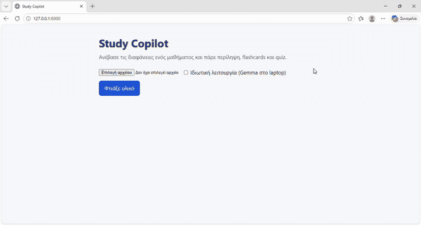

# Study Copilot 🎓⚡

> Transform university lecture PDFs into structured study summaries, 10 active-recall flashcards, and a 5-question quiz in seconds. Supports both Google Gemini (Cloud) and Gemma via Ollama (100% Private & Offline), with full Model Context Protocol (MCP) agent support.



---

## ✨ Features

- **📑 Smart Lecture Summary**: Extracts 6–8 essential takeaway points with exact slide/page references so you can always verify context.
- **🗂️ Interactive Flashcards**: 10 question-and-answer flip cards tailored for active recall and spaced repetition.
- **📝 Self-Assessment Quiz**: 5 multiple-choice questions with 4 options each, instant grading, answer explanations, and citation of source pages.
- **⚡ Dual Engine**:
  - **Cloud Mode (Google Gemini)**: Blazing fast multi-modal analysis using `gemini-flash-lite-latest` on Google's free tier.
  - **Private Mode (Local Gemma via Ollama)**: 100% on-device processing with `gemma3:1b`. No data ever leaves your computer—works completely offline.
- **🤖 Built-in MCP Server**: Expose Study Copilot tools directly to AI coding agents (Google Antigravity, Claude Desktop, Cursor, etc.).

---

## 🚀 3-Command Quick Start

```bash
git clone https://github.com/fentzina/study-copilot.git && cd study-copilot
pip install -r requirements.txt
python app.py
```

> **Note:** Copy `.env.example` to `.env` and add your free Gemini API key (see below), or check **"Private Mode"** in the web app to run locally with Ollama. Then open [http://localhost:8000](http://localhost:8000).

---

## 🔑 How to Get a Free Gemini API Key

Study Copilot uses Google's free tier for cloud processing. No credit card is required.

1. Go to **[Google AI Studio](https://aistudio.google.com/)**.
2. Sign in with your Google account.
3. Click **"Get API key"** in the sidebar, then click **"Create API key"**.
4. Create your local `.env` file from the template:
   ```bash
   cp .env.example .env
   ```
5. Open `.env` and paste your API key:
   ```env
   GEMINI_API_KEY=AIzaSy...your_actual_key_here...
   ```

> 🔒 **Security Notice:** The `.env` file is listed in `.gitignore` by default. **Never commit your `.env` file or share your API key publicly.**

---

## 🛡️ How to Use Private Mode with Ollama

Keep all sensitive university slides and notes strictly on your laptop. Private mode requires no API key, incurs no quota limits, and works completely offline without internet access.

1. **Install Ollama**:
   Download and install from **[ollama.com/download](https://ollama.com/download)** (Windows, macOS, or Linux).

2. **Pull the lightweight Gemma model**:
   ```bash
   ollama pull gemma3:1b
   ```
   *(Ensure Ollama is running in the background. If needed, start it with `ollama serve`).*

3. **Analyze in Private Mode**:
   - In the Study Copilot Web UI, tick the **"Ιδιωτική λειτουργία" (Private mode)** checkbox before clicking **Analyze** (Ανάλυση).
   - Text is extracted locally using `pypdf` and passed to Ollama using strict JSON schema validation. Zero bytes leave your machine.

---

## 🤖 How to Add the MCP Server to an Agent

Study Copilot includes a built-in **Model Context Protocol (MCP)** server (`mcp_server.py`), allowing AI agents to analyze PDFs, create flashcards, and run quizzes directly within their workflow.

### Exposed MCP Tools

| Tool | Parameters | Description |
|---|---|---|
| `summarize_lecture` | `pdf_path: str`, `private: bool = False` | Extracts summary bullet points with page citations. |
| `make_flashcards` | `pdf_path: str`, `count: int = 10`, `private: bool = False` | Generates Q&A flashcards for active study. |
| `make_quiz` | `pdf_path: str`, `questions: int = 5`, `private: bool = False` | Generates multiple-choice quiz questions with answer index & explanations. |

### Configuration

Add Study Copilot to your agent's MCP configuration file:

#### 1. Google Antigravity (`~/.gemini/config/mcp_config.json`)
```json
{
  "mcpServers": {
    "study-copilot": {
      "command": "python",
      "args": ["/ABSOLUTE/PATH/TO/study-copilot/mcp_server.py"]
    }
  }
}
```

#### 2. Claude Desktop (`claude_desktop_config.json`)
```json
{
  "mcpServers": {
    "study-copilot": {
      "command": "python",
      "args": ["/ABSOLUTE/PATH/TO/study-copilot/mcp_server.py"]
    }
  }
}
```

> 💡 **Tip for Windows / Virtual Environments:** Use the absolute path to your Python interpreter and server file, e.g.:
> - `command`: `"C:\\Users\\user\\Downloads\\study-copilot\\.venv\\Scripts\\python.exe"` (or `"python"`)
> - `args`: `["C:\\Users\\user\\Downloads\\study-copilot\\mcp_server.py"]`

### Example Prompt for Your Agent

```text
Use study-copilot to quiz me on sample_lectures/LectureImaging_1.pdf with 3 questions in private mode, one at a time, and grade my answers.
```

---

## 🧪 Running Tests

Tests use mocked model responses and mock PDF streams—no API keys or external services required:

```bash
pytest
```

---

## 📄 License

MIT License. See [LICENSE](LICENSE) for details.
